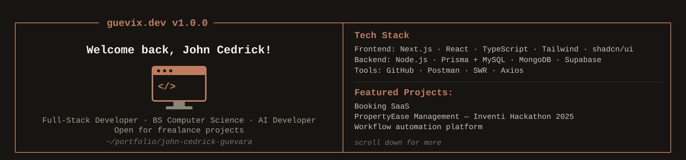

<div align="center">



</div>

```
> tell me more about this dev
```

```
⏺ I'll pull together a quick profile.

⏺ Read(about.md)
  ⎿  Passionate full-stack developer who loves turning ideas
     into real, working systems. Specializes in modern, scalable
     web apps with clean architecture, performance, and UX in mind.
     Currently expanding into AI integration for web apps —
     exploring how intelligent automation can enhance user
     workflows and product design.

⏺ Glob(projects/**)
  ⎿  Found 4 projects

⏺ Read(projects/inventory-dashboard.md)
  ⎿  Time-Filtered Inventory and Sales Dashboard
     - Full admin control over staff, products, sales, categories
     - Real-time inventory tracking — stock updates on purchase
     - Pagination, search, and product filters
     - Role-Based Access Control (RBAC) + responsive design

⏺ Read(projects/property-ease.md)
  ⎿  PropertyEase Management — Inventi Hackathon 2025
     - Google Calendar integration for scheduling
     - Automated assignment of maintenance tickets
     - Full admin control over maintenance operations
     - RBAC + responsive design

⏺ Read(projects/aidlink.md)
  ⎿  AidLink: Web-Based Charity Platform
     - Admin dashboard for users, proposals, sectors, submissions
     - Community project submissions and donations
     - Payment gateway integration
     - RBAC + responsive design

⏺ Read(projects/olcom.md)
  ⎿  OLCOM: OLOPSC Community Platform
     - Contributed as Full-Stack Developer
     - Admin control over users, announcements, events, lost & found
     - Real-time chat + lost-and-found functionality
     - RBAC + responsive design

⏺ Done — profile compiled.
```

```
> git log --oneline --graph --decorate | head -1
```

```
* "Clean code is not just written — it's designed, tested, and refined with purpose."
```


```
> whereis john
```
<div align="center">

📫 **Email:** [guevarajohncedrick0610@gmail.com](mailto:guevarajohncedrick0610@gmail.com)
🌐 **Portfolio:** [guevix.vercel.app](https://guevix.vercel.app)
💼 **LinkedIn:** [john-cedrick-guevara](https://www.linkedin.com/in/john-cedrick-guevara-66381027b/)

</div>

<div align="center">


</div>

```
$ ▌
```
